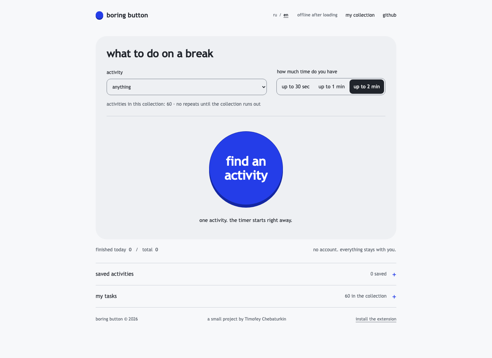
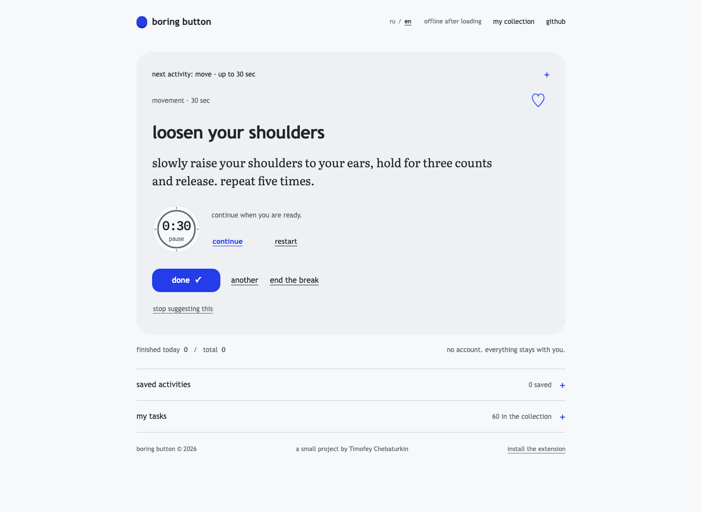
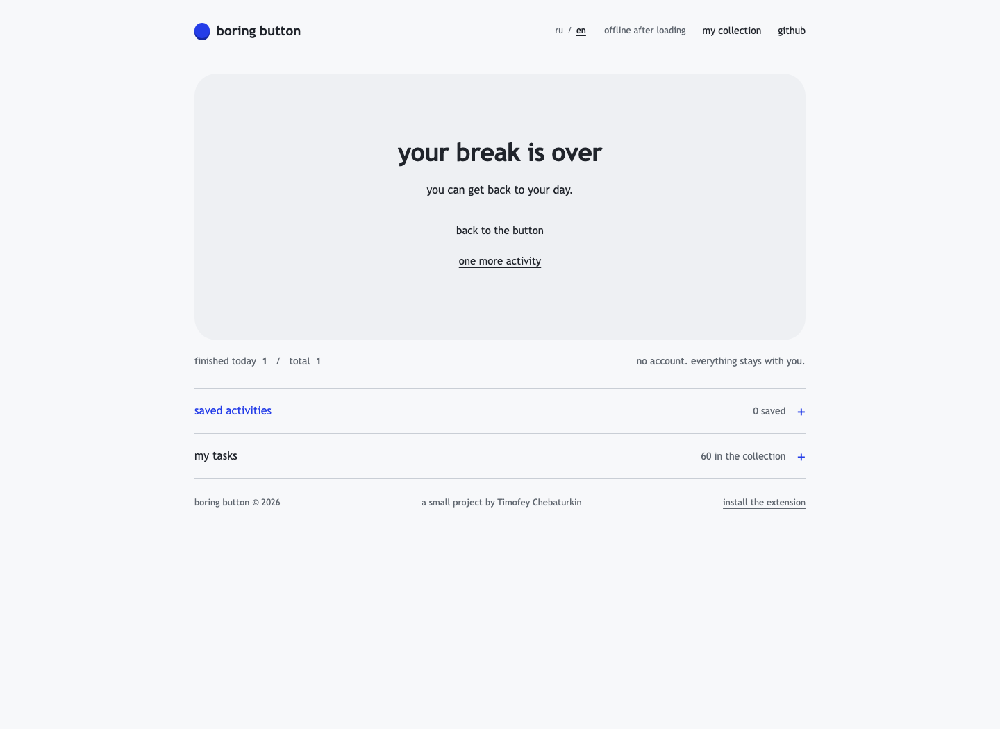
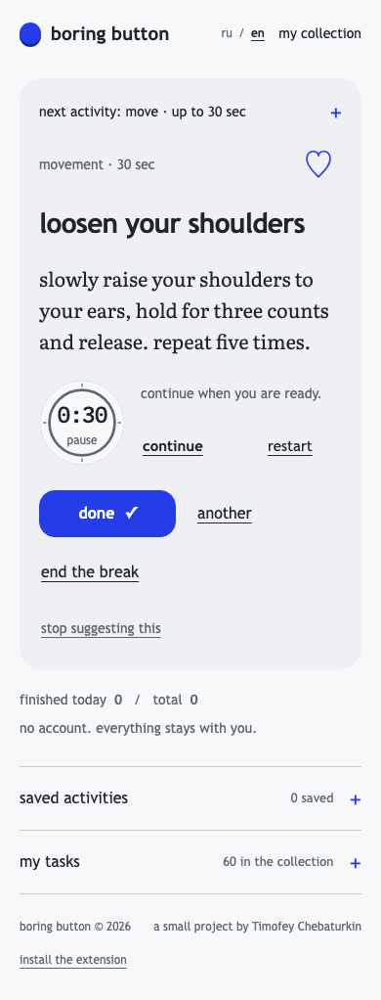

**english** · [русский](README.ru.md)

<p></p>

# boring button

short activities for a break at your computer. choose a mood and duration, press the button and get one thing to do: move, reset, tidy up or play. a pause takes between 10 seconds and two minutes.

**[press the button →](https://chebaturkin.github.io/boring-button/?lang=en)** · [extension](#extension) · [local development](#development) · [русская версия](https://chebaturkin.github.io/boring-button/?lang=ru)



## taking a break

1. choose an activity and duration, or leave “anything” and “up to 2 min”.
2. press **“find an activity”**. the timer starts automatically.
3. do the activity. use **“another”** or **“end the break”** if it does not fit.
4. press **“done”** when you finish and get back to your day.

the library has 60 activities, all available in english and russian. a collection does not repeat until every activity has appeared; that history survives reopening. changing the mood or duration starts a new round. a collection with one activity can repeat. filters affect the next pick and keep your current timer running.

the quiet **ru / en** control changes the interface in place. a `?lang=en` or `?lang=ru` link takes priority, followed by your saved choice, the first supported browser language, and english. switching keeps your timer, selections and unfinished form. your own task text stays as you wrote it.

## your collection

- **favorites:** press ♡ to save an activity. start a specific one from saved activities, or choose a random favorite within your time limit.
- **hidden activities:** “stop suggesting this” removes an activity from random picks and the saved list. restore it through “my collection → hidden activities → restore”. its favorite mark is retained; hiding does not count as completion or skipping.
- **timer:** pause, resume or restart it. the active task and timer return after reopening the page or popup.
- **custom tasks:** add, edit and move your tasks through json or csv.
- **counters:** today's and all time completed breaks are stored locally.

if no activity matches, the interface suggests more time, another category or restoring a hidden activity.

<details>
<summary>an active task, completion, extension popup and mobile screen</summary>





<p></p>
<p></p>

</details>

these are screenshots of the working application. the site and extension share styles and behavior. your system's reduced motion preference disables animations.

## extension

a manifest v3 extension for chrome and edge, installed unpacked. it is not published in a browser store.

1. [download the repository](https://github.com/chebaturkin/boring-button/archive/refs/heads/main.zip) and unpack it.
2. open `chrome://extensions` or `edge://extensions`.
3. enable **Developer mode**.
4. choose **Load unpacked** and select `extension/`.
5. pin boring button in your browser toolbar.

a running timer continues against your device clock when the popup closes. a paused timer stays paused. see the [extension instructions](extension/README.md).

## data stays with you

the site loads only its own files. after loading, activities, fonts, timers and file operations make no network requests. you can open `index.html` directly with `file://`. the extension works offline.

there are no accounts, ads, analytics or ai. the manifest has no `permissions`, `host_permissions` or content scripts: it does not read tabs, history or page contents.

`localStorage` holds custom tasks, favorites, hidden activities, selection history, preferences, counters and the current activity. the language choice uses a separate key. the site and extension keep separate data; there is no device sync. imports and exports run in the browser. exports contain only custom tasks. deleting your tasks and resetting statistics ask for confirmation.

## keyboard

| key | action |
| --- | --- |
| `Enter` | start an activity or get the next one |
| `D` | mark as done |
| `S` / `Escape` | skip; `Escape` also closes settings |
| `N` | another activity |
| `Tab` / `Shift+Tab` | move between controls |
| `Space` | activate the focused button |

shortcuts do not run in inputs, editable text, links or disclosure summaries. ctrl/cmd/alt combinations, held keys and text composition do not change the activity. focus is visible, statuses use `aria-live`, and system contrast colors are supported.

## custom tasks and imports

“my tasks” accepts a title up to 80 characters, instructions up to 240 and a duration from 10 to 120 seconds. limits: 200 custom tasks and a file up to 1 mb. invalid rows and duplicates are skipped; integer durations outside the range are clamped.

json accepts an array or an object with `tasks`:

```json
{
  "tasks": [
    {
      "id": "custom-window-01",
      "category": "observation",
      "title": "five round objects",
      "prompt": "find five round objects around you.",
      "durationSec": 30
    }
  ]
}
```

csv uses `id,category,title,prompt,durationSec` headers. wrap values containing commas or newlines in double quotes. favorites and statistics are not exported. technical keys and imported text are retained in either language.

## development

static html, css and javascript. no build or runtime dependencies.

```bash
python3 -m http.server 8000 --bind 127.0.0.1
```

open the [local site in english](http://127.0.0.1:8000/?lang=en). you can also open `index.html` directly; a local server is useful for browser checks and the extension preview.

the interface lives in `index.html`, `styles.css`, `app.js`, `core.js` and `i18n.js`. `tasks.json` is the canonical built-in task library. `extension/` contains the ready to load extension. local literata and ibm plex mono fonts and their licenses are in `assets/fonts/`.

after changing tasks or interface code, synchronize the copies and check them:

```bash
node scripts/sync-tasks.js
node scripts/sync-ui.js
node --test tests/*.test.*
node --check app.js
node --check extension/popup.js
```

browser checks and screenshot capture need node.js, playwright and chromium. install the optional check tools in the repository root:

```bash
npm install --no-save --package-lock=false playwright
npx playwright install chromium
```

keep the local server running, then run the checks. the last command refreshes the english and russian readme images:

```bash
BORING_BUTTON_URL=http://127.0.0.1:8000 node scripts/verify-workspace.cjs
BORING_BUTTON_URL=http://127.0.0.1:8000 node scripts/verify-browser.cjs
BORING_BUTTON_URL=http://127.0.0.1:8000 node scripts/verify-selection.cjs
BORING_BUTTON_URL=http://127.0.0.1:8000 node scripts/verify-motion.cjs
BORING_BUTTON_URL=http://127.0.0.1:8000 node tests/i18n-browser.cjs
BORING_BUTTON_URL=http://127.0.0.1:8000 node scripts/capture-screenshots.cjs
```

checks cover filters, complete selection rounds, hiding and restoring, favorites, timer recovery, completion, keyboard, custom tasks, imports/exports, two tabs, both languages and mobile widths. the motion check also covers reduced motion, touch, 200 custom tasks, offline use and `file://`.

check extension installation and recovery after closing the popup separately through `chrome://extensions`.

## publication

the repository root is a ready static site. in github **settings → pages**, select **deploy from a branch**, `main` and `/ (root)`. `.nojekyll` keeps files unprocessed; relative asset paths also work under a repository subpath. updates appear after the pages deployment completes.

## fonts and references

the bundled fonts retain their licenses: [literata](assets/fonts/OFL-Literata.txt) and [ibm plex mono](assets/fonts/LICENSE-IBM-Plex-Mono.txt). the extension includes the same fonts and notices.

these projects informed the interaction design. their code, activities and assets are not included:

- [stretchly selection](https://github.com/hovancik/stretchly/blob/3d87a189c6c7ca8281955834cb59c41f3ceccfa7/app/utils/shuffled.js): a complete round before repeating and disabled activities; [bsd-2-clause](https://github.com/hovancik/stretchly/blob/3d87a189c6c7ca8281955834cb59c41f3ceccfa7/LICENSE).
- [breaktimer progress](https://github.com/tom-james-watson/breaktimer-app/blob/2d672434e9807d11ba91d126eaccfabd6af6931b/app/renderer/components/break/break-progress.tsx): deadline-based timing; [gpl-3.0](https://github.com/tom-james-watson/breaktimer-app/blob/2d672434e9807d11ba91d126eaccfabd6af6931b/LICENSE.md).
- [pomotroid shortcuts](https://github.com/Splode/pomotroid/blob/dda06e6bf412bebe5ef8668a4357c52d974dc874/src/lib/utils/localShortcuts.ts): commands that respect text input; [mit](https://github.com/Splode/pomotroid/blob/dda06e6bf412bebe5ef8668a4357c52d974dc874/LICENSE).
