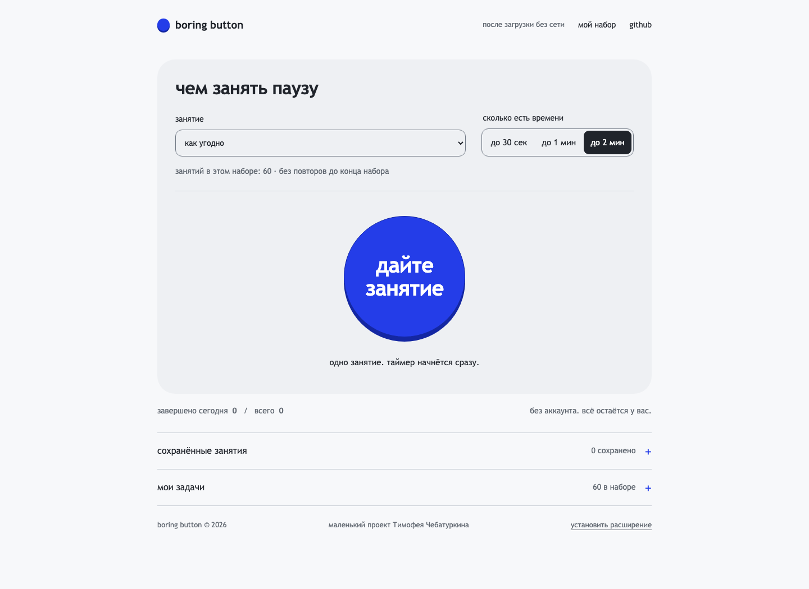
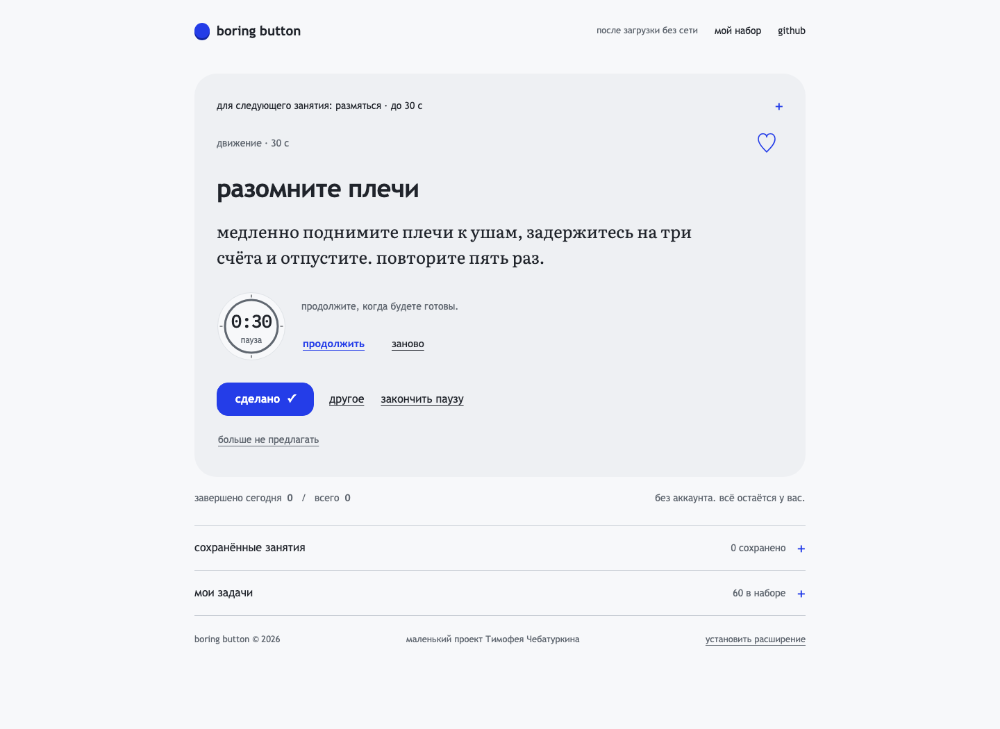
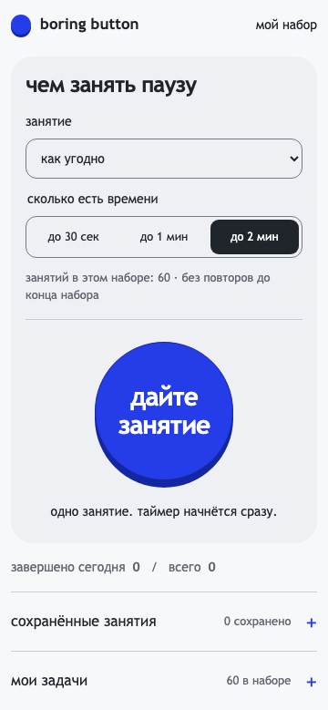
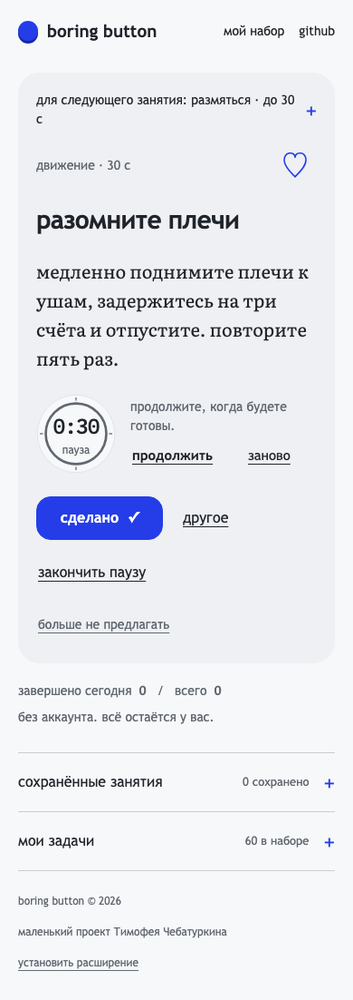

<p></p>

# boring button

короткие занятия для перерыва за компьютером. выберите настроение и время, нажмите кнопку и получите одно дело: размяться, переключиться, навести порядок или поиграть. пауза занимает от 10 секунд до двух минут.

**[нажать кнопку →](https://chebaturkin.github.io/boring-button/)** · [установить расширение](#расширение) · [запустить локально](#разработка)



## как пользоваться

1. выберите занятие и время. можно оставить «как угодно» и «до 2 мин»;
2. нажмите **«дайте занятие»**. таймер начнётся сам;
3. выполните задание. если оно не подходит, нажмите **«другое»** или **«закончить паузу»**;
4. нажмите **«сделано»**, когда закончите. можно вернуться к своим делам.

в библиотеке 60 занятий. в выбранном наборе они не повторяются, пока не покажутся все; история сохраняется между открытиями. смена настроения или времени начинает новый круг. если доступно одно занятие, оно может повторяться. фильтры меняют следующий выбор и сохраняют текущий таймер.

## ваш набор

- **избранное.** нажмите ♡ у занятия. в разделе «сохранённые занятия» можно начать конкретное, а режим «из сохранённых» выбирает случайное с учётом времени;
- **скрытые занятия.** кнопка «больше не предлагать» убирает занятие из выбора и списка сохранённых. вернуть его можно через «мой набор → скрытые занятия → вернуть». отметка избранного сохраняется; скрытие не считается выполнением или пропуском;
- **таймер.** его можно приостановить, продолжить и начать заново. занятие и таймер восстанавливаются после закрытия страницы или popup;
- **свои задачи.** добавляйте, редактируйте и переносите их через json или csv;
- **счётчики.** завершённые паузы за сегодня и за всё время хранятся локально.

если подходящих занятий нет, интерфейс предлагает добавить времени, сменить раздел или вернуть скрытое.

<details>
<summary>занятие с таймером, расширение и мобильный экран</summary>



<p></p>

<p></p>

</details>

скриншоты сняты с работающего приложения. сайт и расширение используют общие стили и логику. системная настройка уменьшения движения отключает анимации.

## расширение

распакованное расширение manifest v3 для chrome и edge. в каталоге браузера пока не опубликовано.

1. [скачайте репозиторий](https://github.com/chebaturkin/boring-button/archive/refs/heads/main.zip) и распакуйте;
2. откройте `chrome://extensions` или `edge://extensions`;
3. включите **Developer mode**;
4. нажмите **Load unpacked** и выберите папку `extension/`;
5. закрепите boring button на панели браузера.

запущенный таймер продолжает идти по времени устройства после закрытия popup. таймер на паузе остаётся на паузе. подробности есть в [инструкции расширения](extension/README.md).

## данные остаются у вас

сайт загружает только свои файлы. после загрузки занятия, шрифты, таймер и работа с файлами не обращаются к сети. страницу можно открыть прямо из папки через `file://`. расширение работает офлайн.

аккаунтов, рекламы, аналитики и ai нет. в manifest отсутствуют `permissions`, `host_permissions` и content scripts: расширение не читает вкладки, историю или содержимое страниц.

в `localStorage` хранятся свои задачи, избранное, скрытые занятия, история выбора, настройки, счётчики и активное занятие. сайт и расширение хранят данные отдельно; синхронизации между устройствами нет. импорт и экспорт обрабатываются в браузере. экспорт переносит только свои задачи. удаление своих задач и сброс статистики требуют подтверждения.

## клавиатура

| клавиша | действие |
| --- | --- |
| `Enter` | начать занятие или получить следующее |
| `D` | отметить сделанное |
| `S` / `Escape` | пропустить; `Escape` также закрывает настройки |
| `N` | другое занятие |
| `Tab` / `Shift+Tab` | перейти между элементами |
| `Space` | нажать выбранную кнопку |

горячие клавиши не срабатывают в полях, редактируемом тексте, ссылках и раскрывающихся заголовках. сочетания с ctrl/cmd/alt, удержание клавиши и композиция ввода не меняют занятие. фокус виден, статусы объявляются через `aria-live`, системные контрастные цвета поддерживаются.

## свои задачи и импорт

раздел «мои задачи» принимает название до 80 символов, инструкцию до 240 и время от 10 до 120 секунд. лимит: 200 своих задач и файл до 1 мб. повреждённые строки и дубликаты пропускаются; целочисленное время вне диапазона приводится к его границам.

json принимает массив или объект с полем `tasks`:

```json
{
  "tasks": [
    {
      "id": "custom-window-01",
      "category": "наблюдение",
      "title": "пять круглых предметов",
      "prompt": "найдите глазами пять круглых предметов вокруг себя.",
      "durationSec": 30
    }
  ]
}
```

csv использует заголовки `id,category,title,prompt,durationSec`. значения с запятой или переносом строки заключайте в двойные кавычки. избранное и статистика в экспорт не входят.

## разработка

статический html, css и javascript. сборка и зависимости для работы приложения не нужны.

```bash
python3 -m http.server 8000 --bind 127.0.0.1
```

откройте [локальный сайт](http://127.0.0.1:8000). публикация на github pages описана в [отдельной инструкции](docs/github-pages.md).

источники интерфейса находятся в `index.html`, `styles.css`, `app.js` и `core.js`. источник встроенных занятий: `tasks.json`. папка `extension/` содержит готовое расширение, а `assets/fonts/` содержит локальные literata и ibm plex mono с лицензиями.

после изменения задач или интерфейса синхронизируйте копии и запустите проверки:

```bash
node scripts/sync-tasks.js
node scripts/sync-ui.js
node --test tests/*.test.js
node --check app.js
node --check extension/popup.js
```

для браузерных проверок и обновления скриншотов нужен playwright:

```bash
BORING_BUTTON_URL=http://127.0.0.1:8000 node scripts/verify-workspace.cjs
BORING_BUTTON_URL=http://127.0.0.1:8000 node scripts/verify-browser.cjs
BORING_BUTTON_URL=http://127.0.0.1:8000 node scripts/verify-selection.cjs
BORING_BUTTON_URL=http://127.0.0.1:8000 node scripts/verify-motion.cjs
BORING_BUTTON_URL=http://127.0.0.1:8000 node scripts/capture-screenshots.cjs
```

проверки проходят фильтры, полный круг выбора, скрытие и возврат, избранное, таймер и восстановление, завершение, клавиатуру, свои задачи, импорт/экспорт, две вкладки и семь ширин от 320 до 1440 пикселей. проверка движения дополнительно проходит уменьшение анимаций, сенсорное управление, 200 своих задач, офлайн и `file://`.

установку расширения и восстановление после закрытия popup проверьте отдельно через `chrome://extensions`. источники идей и лицензии собраны в [исследовании аналогов](docs/analogues.md).
