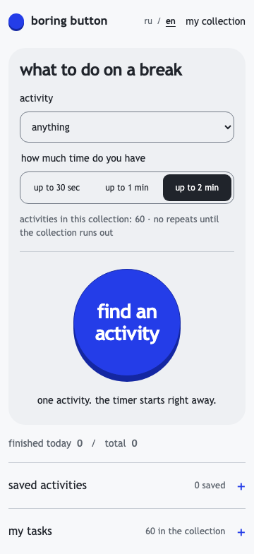

**english** · [русский](README.ru.md)

# boring button: extension

a short activity for a break at your computer. choose a mood and duration, press the blue button and take 10 to 120 seconds away from the feed.



## install in chrome or edge

1. download and unpack the repository.
2. open `chrome://extensions` or `edge://extensions`.
3. enable **Developer mode**.
4. choose **Load unpacked** and select this `extension/` directory.
5. pin boring button in the toolbar.

the extension is not published in a browser store. this manifest v3 version targets chrome and edge; firefox compatibility has not been checked separately.

## activities and data

60 built-in activities, mood and duration filters, favorites, a timer with pause, custom tasks and local import/export. a running timer continues after closing the popup; a paused one stays paused. a collection shows all its activities before repeating. changing filters starts a new round without interrupting the current timer.

use ♡ to save an activity. hide one with “stop suggesting this” and restore it under “my collection → hidden activities”. hiding retains its favorite mark and does not change counters.

the small **ru / en** control changes the interface and built-in activities without clearing your timer or custom tasks. chrome's extension name and description also have english and russian locale files.

the manifest has no `permissions`, `host_permissions` or content scripts. the popup loads only extension files, reads no tabs, history or page contents, and makes no network requests. tasks, favorites, hidden activities, selection history, settings, counters and the current session are saved in extension `localStorage`. the site and popup have separate stores. file contents stay in your browser.

json accepts an array or a `tasks` container. csv headers are `id,category,title,prompt,durationSec`. title and prompt are required. limits: 1 mb per file and 200 custom tasks. see [formats and examples](../README.md#custom-tasks-and-imports).

## keyboard

`Enter`: start or choose another activity; `D`: done; `S`/`Escape`: skip; `N`: another. shortcuts are inactive in fields and links. timer, favorites, settings and language controls are keyboard accessible.

## development

shared files in this directory are generated from the repository root. after changing the source, run:

```bash
node scripts/sync-tasks.js
node scripts/sync-ui.js
node --test tests/*.test.*
```

press **Reload** on the extension card. check start, pause, closing and reopening the popup, completion, favorites, empty collections, imports, both languages and horizontal overflow.
